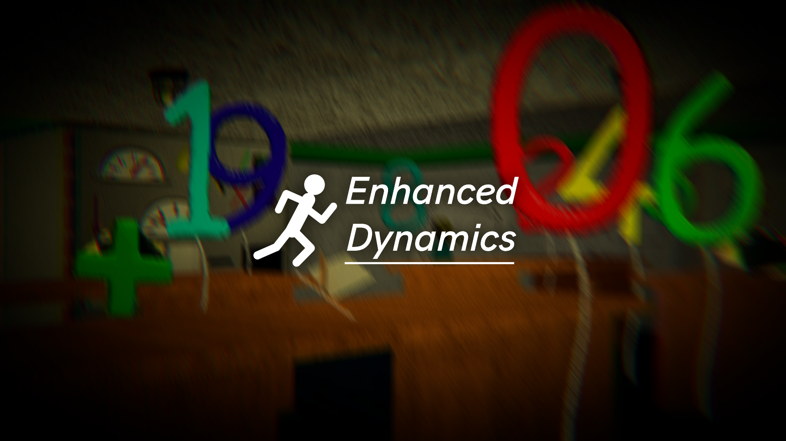

# Enhanced Dynamics

A mod for Baldi's Basics Plus that enhances the game's dynamic, making the gameplay experience more immersive.

## Features

- **Customizable FOV**
- **Camera Effects**
- **Camera Bobbing**
- **Post-Processing**

## Installation

1. Make sure you have [BepInEx](https://github.com/BepInEx/BepInEx) and [MTM101BaldAPI](https://gamebanana.com/mods/383711) (Optional to enable settings tab in game) installed in your Baldi's Basics Plus game
2. Download the latest release of Enhanced Dynamics
3. Place the `EnhancedDynamics.dll` file in your `BepInEx/plugins` folder

## Configuration Options

### Camera Settings:
You can configure such things as: FOV, Bobbing, Idle Inhale, Vertical Camera and FOV Effects.

### Post-Processing
`DISCLAIMER: This category is graphically heavy to turn on. Be sure to have a computer with Discreete GPU with Vulkan or DirectX 11/12 or Metal.`

You can configure some effects that you gonna see, no more need to photoshop you're thumbnails! `Graysland... /j`

## Reqirements

- [Baldi's Basics Plus](https://www.basicallygames.com/baldis-basics-plus)
- [BepInEx](https://github.com/BepInEx/BepInEx)
- [MTM101BaldAPI](https://gamebanana.com/mods/383711) (Optional)

## Bug Reports and Feedback

If you encounter any issues or have suggestions, please report here: https://gitlab.com/imloyness/EnhancedDynamics/-/work_items

## License

This project is licensed under the MIT License - see the [LICENSE](LICENSE) file for details.

## Credits

[ThePartynoob](https://gamebanana.com/members/1882086) - Helping out with some code

[nikilolllz](https://gamebanana.com/members/4916342) - Mod idea

[MikeieYT](https://gamebanana.com/members/4780379) - Post-Processing idea